# 一、前言

笔者认为，在香山处理器（或者任何基于定长指令字指令集设计的处理器）中，每条指令在处理器前端经历的取指过程是与指令本身无关的。

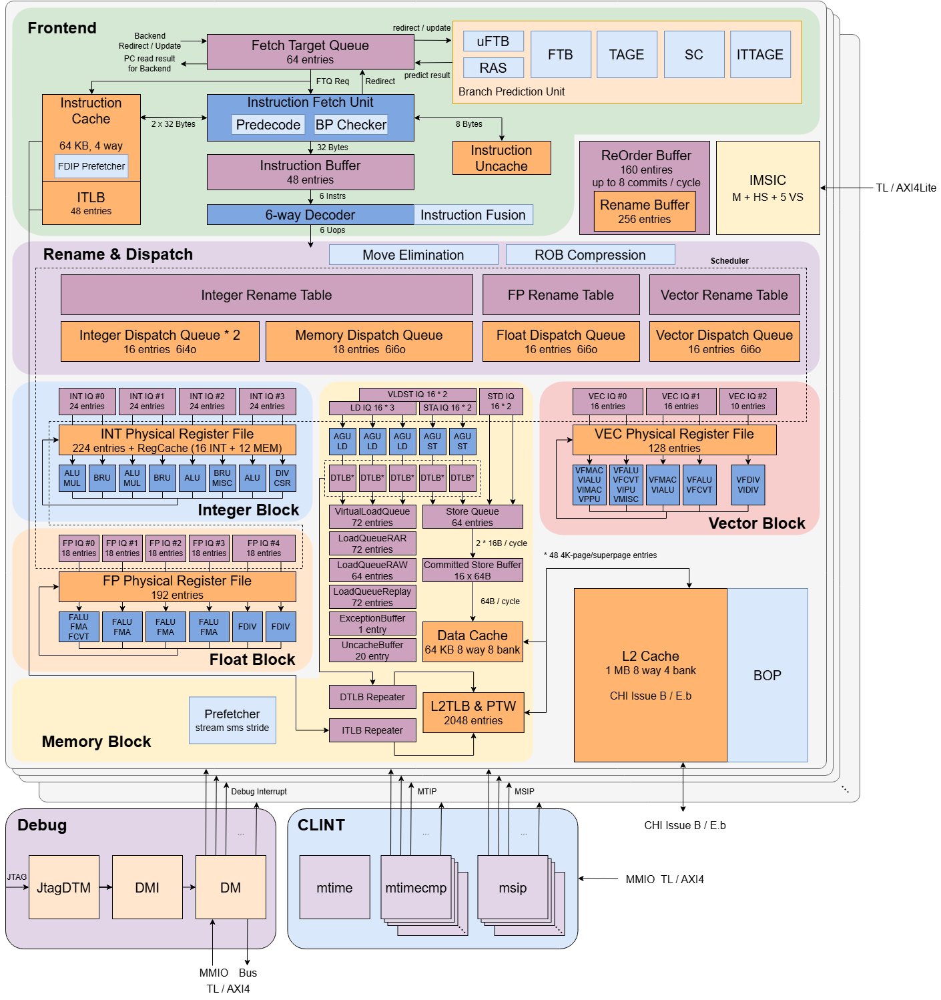

昆明湖 V2R2 微架构框图

如图所示，它们都是同样的从FTQ头部发出请求到icache，然后得到的ops被填入inst buffer缓冲区中（当然也可能走uncache路径），同时考虑到大赛所要求的也是“向量加法指令在香山中的‘执行’过程”，于是本文决定放弃对特定指令在前端取指过程中的波形观察（也就是从PC进入FTQ，以及可能的地址翻译和分支预测阶段的行为观察），转而专注于从inst buffer译码到最终提交的过程分析。

# 二、向量加法vadd.vv指令分析

根据操作数来源不同，RVV中有vadd.vv、vadd.vi、vadd.vx三种类型的向量加法指令，这里我们选用vadd.vv进行测试，也即是两个操作数均来源于向量寄存器的版本。

[VADD.VV 指令：RVV 向量整数加法、掩码与编码 \| RVOPcode](https://rvopcode.com/zh/instructions/vadd-vv)对指令格式和指令行为进行了详细的说明。阅读后我们（借助codex）编写出如下的测试代码，然后进行编译和运行。

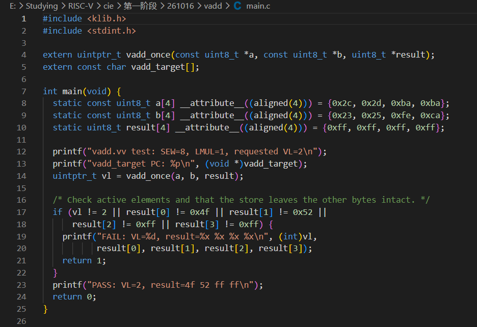

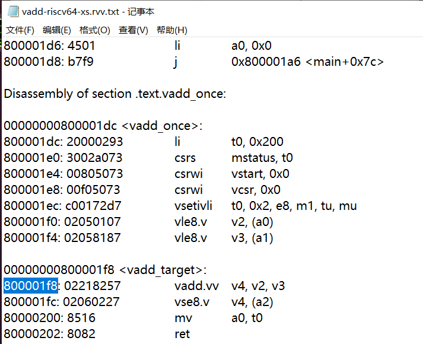

查看反汇编找到vadd.vv指令，这条指令的地址是800001f8，语义是对v2和v3向量寄存器的值做向量加法，然后写到v4寄存器中。根据RVV的规定，还需要考虑800001ec处的vsetivli指令。它对vl和vtype两个CSR进行了配置（[RISC-V Vector的核心概念 - 知乎](https://zhuanlan.zhihu.com/p/20195172242)），直接决定了加法指令（或者任何RVV向量指令）操作数据的方式。这里的指令含义是：请求处理 2 个元素（AVL），每个元素 8 bit（SEW），每个向量寄存器组占用 1 个向量寄存器（LMUL），尾部元素和被屏蔽元素保持原值，并将实际向量长度保存到 t0。也就是：

    for (int i = 0; i < 2; i++) {
        v4[i] = (uint8_t)(v2[i] + v3[i]);
    }

# 三、波形分析

（起初波形范围太大，找不到观察范围内的信号，借助codex对vcd波形进行了裁剪，便于观察）

下面从译码输入的 11521 开始，跟踪到 11600 提交。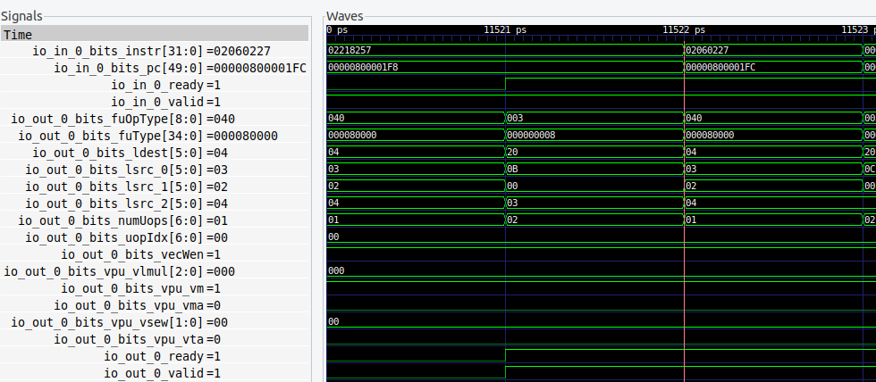

**11521：译码级接收目标指令**

| **信号**             | **本次值** | **含义**                    |
|----------------------|------------|-----------------------------|
| D.io_in_0_valid      | 1          | 通道0的输入指令有效         |
| D.io_in_0_ready      | 1          | 译码级可以接收              |
| D.io_in_0_bits_pc    | 0x800001f8 | 目标指令地址                |
| D.io_in_0_bits_instr | 0x02218257 | vadd.vv v4,v2,v3 的机器编码 |

Valid和ready握手成功，说明指令被译码级成功接收。

**11522：译码结果和微操作输出**

| **信号** | **本次值** | **含义** |
|----|----|----|
| D.io_out_0_valid、D.io_out_0_ready | 均为1 | 译码结果有效且下游可接收 |
| D.io_out_0_bits_fuType | 0x80000 | 选择向量整数运算单元，one-hot 编码 |
| D.io_out_0_bits_fuOpType | 0x40 | 内部操作类型为向量加法 |
| D.io_out_0_bits_vecWen | 1 | 需要写向量寄存器 |
| D.io_out_0_bits_lsrc_0 | 3 | 第一个内部源是 v3，即 vs1 |
| D.io_out_0_bits_lsrc_1 | 2 | 第二个内部源是 v2，即 vs2 |
| D.io_out_0_bits_lsrc_2 | 4 | 旧目的寄存器 v4 |
| D.io_out_0_bits_ldest | 4 | 架构目的寄存器 v4 |
| D.io_out_0_bits_numUops | 1 | 本例只生成一个微操作 |
| D.io_out_0_bits_uopIdx | 0 | 第0个微操作 |

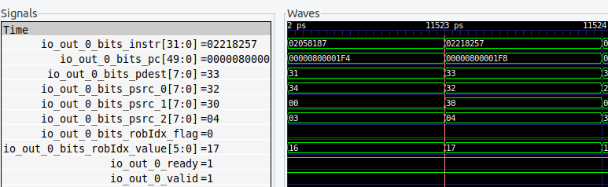

**11523：重命名，分配物理寄存器和 ROB 标识**

| **信号**                           | **本次值** | **含义**                 |
|------------------------------------|------------|--------------------------|
| R.io_out_0_valid、R.io_out_0_ready | 均为1      | 重命名结果被接受         |
| R.io_out_0_bits_psrc_0             | 50         | v3 对应的物理寄存器      |
| R.io_out_0_bits_psrc_1             | 48         | v2 对应的物理寄存器      |
| R.io_out_0_bits_psrc_2             | 4          | 旧 v4 对应的物理寄存器   |
| R.io_out_0_bits_pdest              | 51         | 为新 v4 分配的物理寄存器 |
| R.io_out_0_bits_robIdx_flag        | 0          | ROB 环形指针标志         |
| R.io_out_0_bits_robIdx_value       | 23         | ROB 条目编号             |

从这里开始，主要用 **ROB=(0,23)、pdest=51** 跟踪，而不是一直依赖 PC。

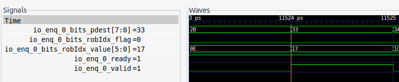

**11524：分发进入向量发射队列**

    IQ.io_enq_0_valid = 1
    IQ.io_enq_0_ready = 1
    IQ.io_enq_0_bits_robIdx_value = 23
    IQ.io_enq_0_bits_pdest = 51

说明目标微操作已进入这个发射队列。

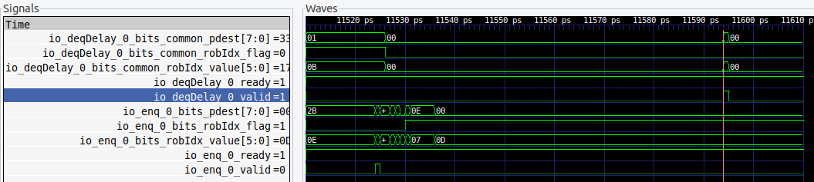

**11525–11593：在队列中等待**

这段时间关注目标是否已从发射接口送出：

    IQ.io_deqDelay_0_valid
    IQ.io_deqDelay_0_bits_common_robIdx_flag
    IQ.io_deqDelay_0_bits_common_robIdx_value
    IQ.io_deqDelay_0_bits_common_pdest

直到11593， valid=1 ，该指令才被发射执行。

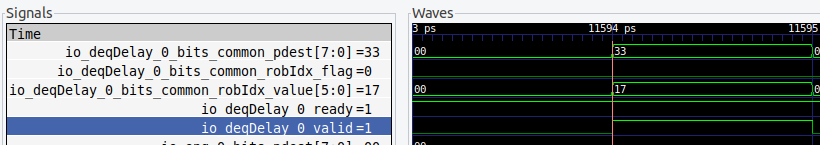

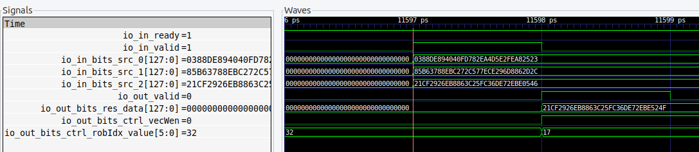

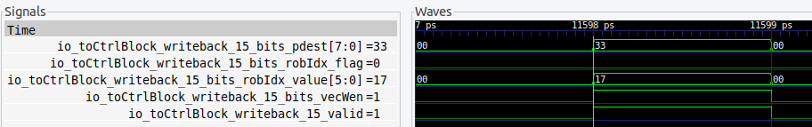

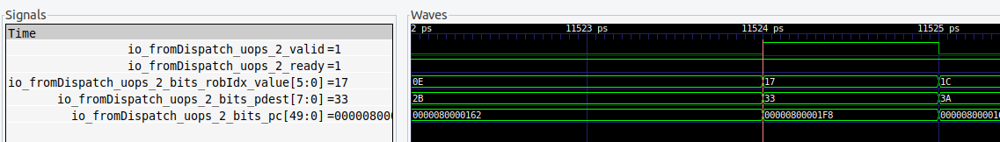

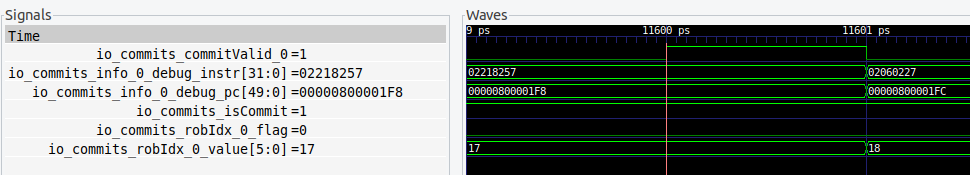

后续各拍接着观察：

| **时间值** | **重点信号及本次值** | **含义** |
|----|----|----|
| **11594** | IQ.io_deqDelay_0_valid=1、ready=1，ROB=23、pdest=51 | 发射请求被下游接受 |
| **11595** | DP.io_toVecExu_1_0_valid=1，ROB=23、pdest=51 | DataPath 输出有效 |
| **11596** | OG.io_toVfArithExu_1_0_valid=1；BP.io_toExus_vf_1_0_valid=1 | 经过 OG2，旁路网络选择源数据 |
| **11597** | EX.io_in_valid=1、io_in_ready=1 | 执行单元接收输入 |
| **11598** | FU.io_out_valid=1；io_out_bits_res_data 低16位=0x524f | 向量加法结果有效 |
| **11598** | WB.io_toCtrlBlock_writeback_15_valid=1 | 向控制块通知执行完成 |
| **11599** | FU.io_out_valid=0；ROB.io_commits_commitValid_0=0 | 结果脉冲结束，尚未提交 |
| **11600** | ROB.io_commits_isCommit=1、io_commits_commitValid_0=1 | 正式提交 |

在 **11597** 检查最终操作数：

    EX.io_in_bits_src_0 低16位 = 0x2523   → v3
    EX.io_in_bits_src_1 低16位 = 0x2d2c   → v2

在 **11600** 再核对提交对象：

    ROB.io_commits_info_0_debug_pc    = 0x800001f8
    ROB.io_commits_info_0_debug_instr = 0x02218257

最终确认提交完成，指令退休。

总结一下执行过程：

| **本次周期** | **执行环节** | **结合设计文档的解释** |
|----|----|----|
| 11521 | 接收指令 | Decode 接收 PC=0x800001f8、编码=0x02218257 |
| 11522 | 向量译码、拆分输出 | 识别 vialuF/vadd_vv，经过复杂译码路径，生成一个微操作 |
| 11523 | 重命名 | 查询源映射，分配新目的物理寄存器：psrc=50/48/4，pdest=51 |
| 11524 | 分派入 IQ | 微操作进入向量发射队列，开始跟踪操作数就绪情况 |
| 11525–11593 | 调度等待 | IQ 等待依赖、资源和选择条件满足；具体阻塞原因尚未逐源确认 |
| 11594 | 发射、进入 OG0 | 发射请求进入操作数生成路径，进行寄存器读口等仲裁 |
| 11595 | OG1 | 得到寄存器堆读出的候选数据 |
| 11596 | OG2、旁路选择 | 向量数据额外打拍，再选择最终操作数 |
| 11597 | 执行入口 | 经过当前源码中的入口寄存级，exus_2 接收操作数 |
| 11598 | 运算结果、写回通知 | 结果低16位为 0x524f，写回控制路径有效 |
| 11599 | 尚未提交 | 执行结果有效脉冲已结束，提交信号仍为0 |
| 11600 | 顺序提交 | ROB 提交通道0有效，PC和指令编码匹配 |
