按照[XiangShanLab/xiangshan-course/docs/1-xiangshan-development-environment/Chapter_1_Overview_of_the_Xiangshan_Development_Environment.md at master · OpenXiangShan/XiangShanLab](https://github.com/OpenXiangShan/XiangShanLab/blob/master/xiangshan-course/docs/1-xiangshan-development-environment/Chapter_1_Overview_of_the_Xiangshan_Development_Environment.md)处的引导进行如下步骤。

克隆环境仓库、配置环境：

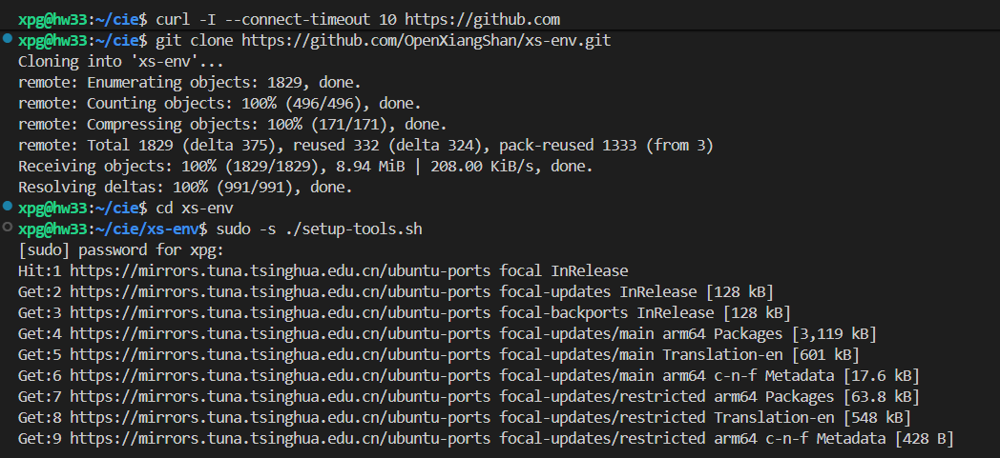

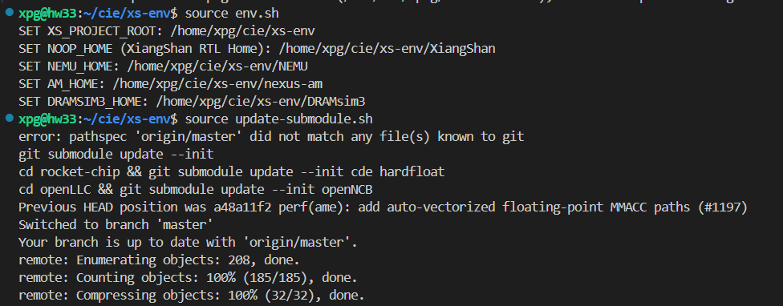

编译香山仿真器：

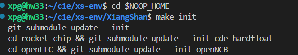

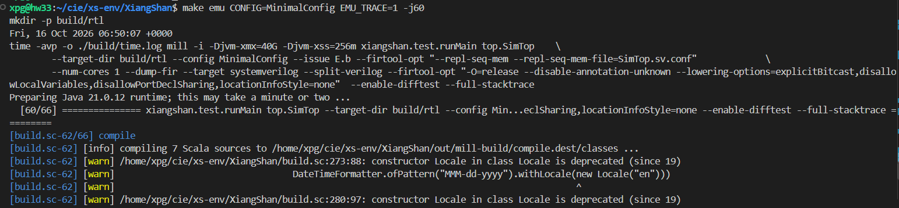

修改hello程序，使之符合大赛的提交要求（由于没有说明需要哪个IP地址，这里用了校园网的出口公网IP）：

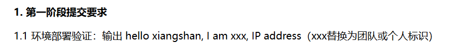

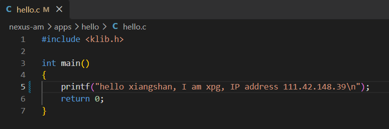

编译hello程序：

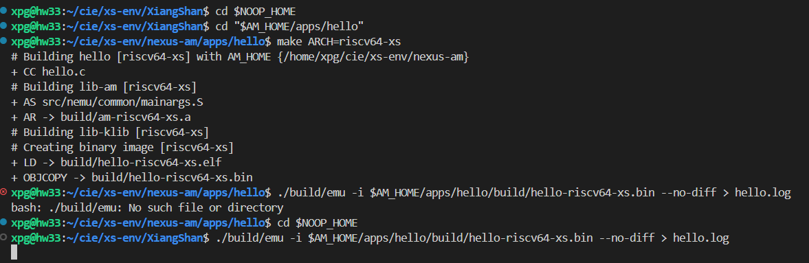

运行hello程序，得到目标输出：

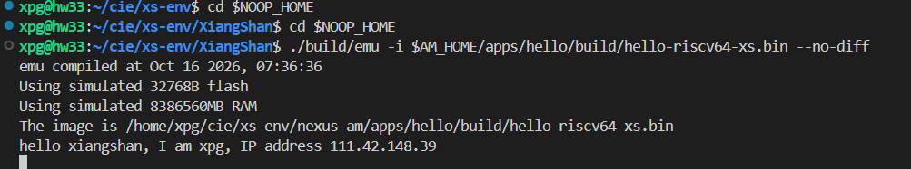

编写含向量加法的vadd程序，编译并运行，同时开启波形保存：

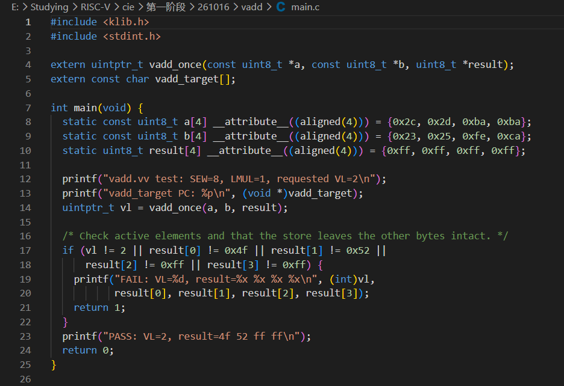

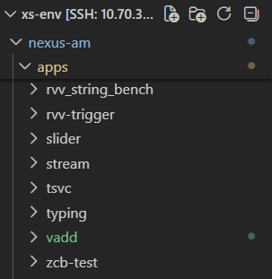

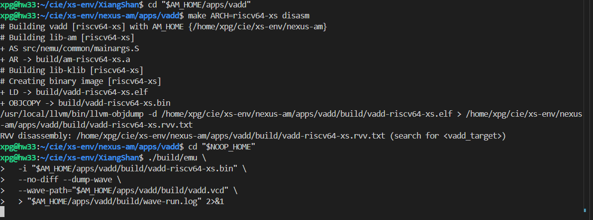

波形分析见“向量加法指令vadd.vv执行过程分析.md”文档
