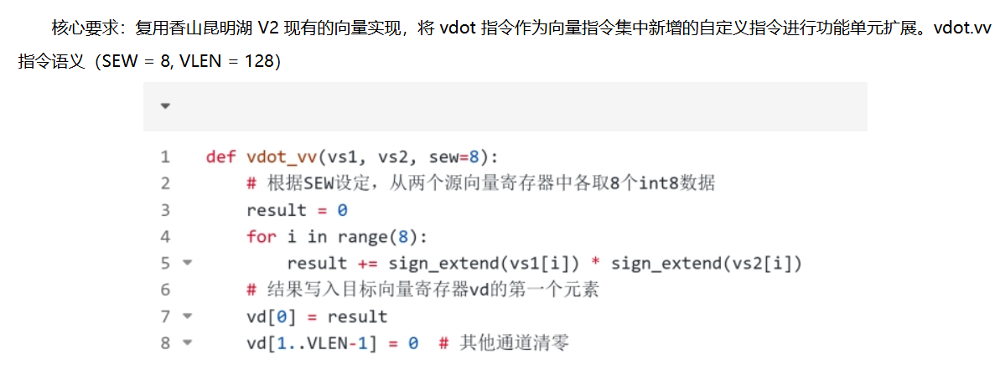

# vdot.vv 自定义向量点积指令设计与实现

## 1. 指令语义

### 1.1 指令编码

```text
 31       26 25 24       20 19       15 14    12 11        7 6         0
+-----------+--+-----------+-----------+--------+-----------+-----------+
|  000000   |1 |    vs2    |    vs1    |  000   |    vd     |  0001011  |
+-----------+--+-----------+-----------+--------+-----------+-----------+
   funct6   vm                          funct3                opcode
```

### 1.2 汇编格式

```asm
vdot.vv vd, vs2, vs1
```

`vd` 为目标向量寄存器，`vs2` 和 `vs1` 为源向量寄存器组，源寄存器组的大小由 `LMUL` 决定。

### 1.3 指令功能

#### 1.3.1 功能描述

`vdot.vv` 将两个源向量寄存器组中索引满足 `vstart ≤ i < vl` 的有符号 8 位整数逐对相乘，再将乘积相加，得到一个 32 位点积结果。结果以二进制补码写入目标寄存器低 32 位，高 96 位全部清零。指令正常完成后将 `vstart` 清零。

#### 1.3.2 函数定义

`vs1[i]`、`vs2[i]` 表示源寄存器组中的第 `i` 个 int8 元素，`sign_extend` 表示将其符号扩展至 32 位。

```text
def vdot_vv(vs1, vs2, vstart, vl, sew=8):
    # 计算索引范围[vstart, vl)内的INT8元素点积
    result = 0
    for i in range(vstart, vl):
        result += sign_extend(vs1[i]) * sign_extend(vs2[i])
    # 结果写入目标寄存器低32位，高 96 位全部清零
    vd[31:0] = result
    vd[127:32] = 0
    vstart = 0
```

### 1.4 注意
- 目前 `SEW` 仅支持8位，为其他值时触发非法指令异常。
- 仅支持无掩码执行（`vm=1`）；当 `vm=0` 时，触发非法指令异常。
- 要求 `vstart=0` ；非零时触发非法指令异常。
- 当 `vl=0` 时，不修改目标寄存器，但不会因此触发异常，完成后将 `vstart` 清零。
- 执行结果写回时，目标寄存器高 96 位固定清零，不受 `vta` 、`vma` 影响。
- 除本指令已明确的特殊行为外，源寄存器组遵循[RISC-V V 向量扩展规范 v1.0](https://github.com/riscvarchive/riscv-v-spec/blob/v1.0/v-spec.adoc)第 3.4.2 节的 LMUL 分组与对齐规则；其余向量状态检查与异常行为遵循第 3.2、3.3 节（向量上下文状态）、第 3.4.4 节（`vill`）及第 3.7 节（`vstart`）。


## 2. 微架构设计

### 2.1 总体思想

根据指令定义，`vdot.vv` 需要读取两个源向量寄存器组，根据 `vl` 计算有符号 INT8 元素的点积，并将结果写入目标向量寄存器。考虑到点积运算本质上由乘法和累加两部分组成，本文选择复用香山昆明湖 V2 现有的向量整数乘加功能单元 `VIMAC`，通过增加完整乘积提取、归约求和及结果选择逻辑，实现对 `vdot.vv` 指令的支持，从而尽可能复用原向量单元的数据通路。

首先，在处理器前端和访存通路方面，`vdot.vv` 采用现有的 32 位定长指令编码，不涉及控制流变化，因此无需修改取指、指令缓存和分支预测等模块。同时，该指令的源操作数和运算结果均位于向量寄存器中，不涉及直接的内存访问，因此地址生成、数据缓存和向量访存单元均可保持原有实现。主要修改集中在指令译码、微操作生成以及向量执行单元。在译码阶段，新增对 `Custom-0` 编码的匹配，将 `vdot.vv` 译码为 `FuType.vimac` 和新增的内部操作类型 `VimacType.vdot`，使其能够沿用现有的向量指令调度通路，并被分派至 `VFEX0` 中的 `VIMAC` 执行。同时，将该指令纳入向量算术指令的识别范围，以复用已有的向量状态检查机制。

在微操作生成方面，源操作数可以是由 `LMUL` 确定的寄存器组，而目标始终为单个 128 位向量寄存器。本文新增 `VEC_DOT` 微操作拆分类型：当 `LMUL≤1` 时生成一个微操作；当 `LMUL=2、4、8` 时分别生成 2、4、8 个微操作。每个微操作读取两个源组中对应的一个寄存器，最多处理 16 对 INT8 元素，并通过第三源传递前一个微操作的部分和。中间结果写入已有的临时向量寄存器，最后一个微操作才写入目标，避免目标与源重叠时提前覆盖尚未读取的数据。考虑到两个 `VIMac64b` 已具备处理相应数据宽度的乘法能力，因此可以直接复用它们完成每个数据块的乘法运算，无需额外增加独立的乘法器阵列。

在具体执行过程中，`VIMAC` 原有的 Booth 编码和 Wallace 树能够生成乘法运算的完整乘积。本文在原有乘积截取逻辑之前，从两个模块中各引出 8 个 16 位有符号乘积，根据元素的全局索引和 `vl` 将无效乘积置零，再通过四级平衡加法树完成 16 个乘积的归约求和。归约结果经过符号扩展后形成 32 位部分和，与前一个微操作的部分和相加，再与高 96 位的零拼接，生成完整的 128 位写回数据。为尽量保持原有功能单元的时序结构，乘法运算仍经过现有的两级流水寄存器，新增的归约加法树和部分和加法器则放置在第二级寄存器 `walOut` 之后，作为组合输出逻辑。因此，`VimacCfg` 仍保持 `CertainLatency(2)` 的配置，每个微操作不额外增加执行周期；整条指令的执行时间还取决于微操作数量及其数据依赖。

在寄存器重命名、写回和提交方面，`vdot.vv` 继续复用昆明湖 V2 现有的向量寄存器堆、写回端口以及 ROB 提交流程。当 `vl>0` 时，最后一个微操作完整覆盖目标向量寄存器；当 `vl=0` 时，保留目标原值。因此，译码时保留第三源及其依赖，用于零长度处理和跨微操作的部分和传递，但不需要常规的掩码及尾部合并处理。为此，本文在结果处理逻辑中对 `vdot.vv` 和原有向量乘加指令进行区分：前者根据 `vl` 选择完整的 128 位点积结果或旧目标值，后者继续沿用原有的数据处理与写回方式。通过上述设计，新增指令能够在保持原有向量执行框架和两周期功能单元接口基本不变的前提下，复用已有乘法硬件实现点积运算，降低了额外硬件资源开销及对处理器整体微架构的侵入程度。

### 2.2 译码与微操作生成

以下代码路径均相对于香山根目录。

`src/main/scala/xiangshan/backend/decode/Instructions.scala` 新增无掩码点积编码：

```scala
object VDotInstructions {
  // custom-0, funct6=0, vm=1, funct3=0; vd/vs1/vs2 are vector registers.
  def VDOT_VV = BitPat("b0000001??????????000?????0001011")
}
```

编码固定 `vm=1`，三个寄存器编号由通配位给出。`vm=0` 不匹配该译码项，按未实现指令处理。

`src/main/scala/xiangshan/backend/decode/isa/bitfield/RiscvInst.scala` 将自定义编码纳入向量算术指令的识别范围：

```scala
  def isVecArith = {
    this.OPCODE5Bit === xiangshan.backend.decode.isa.bitfield.OPCODE5Bit.OP_V ||
      xiangshan.backend.decode.VDotInstructions.VDOT_VV === this.ALL
  }
```

这样，Custom-0 编码也会进入向量指令的译码和复杂指令拆分流程。

`src/main/scala/xiangshan/backend/decode/VecDecoder.scala` 新增译码项：

```scala
    VDotInstructions.VDOT_VV -> OPIVV(FuType.vimac, VimacType.vdot, T, F, F,
      UopSplitType.VEC_DOT, src3 = SrcType.vp),
```

`FuType.vimac` 选择现有 VIMAC，`VimacType.vdot` 选择内部点积操作。第三源设置为 `SrcType.vp`，用于读取旧目标值或前一微操作的部分和。

`src/main/scala/xiangshan/package.scala` 增加拆分类型：

```scala
def VEC_DOT          = "b100110".U
```

`src/main/scala/xiangshan/backend/decode/UopInfoGen.scala` 使用已有的 LMUL 到寄存器数量的转换：

```scala
  val lmul = MuxLookup(vlmul, 1.U(4.W))(Seq(
    "b001".U -> 2.U,
    "b010".U -> 4.U,
    "b011".U -> 8.U
  ))
```

在微操作数量选择表中增加：

```scala
UopSplitType.VEC_DOT -> lmul,
```

因此，分数 LMUL 和 `LMUL=1` 均生成一个微操作，`LMUL=2、4、8` 分别生成 2、4、8 个。当前拆分数量只由 LMUL 决定，不根据 `vl` 减少微操作。

`src/main/scala/xiangshan/backend/decode/DecodeUnitComp.scala` 生成各微操作的操作数和目标：

```scala
    is(UopSplitType.VEC_DOT) {
      // Keep architectural sources intact until the last chunk is consumed.
      // Renaming chains the temporary partial sums through source 2.
      for (i <- 0 until MAX_VLMUL) {
        csBundle(i).lsrc(0) := src1 + i.U
        csBundle(i).lsrc(1) := src2 + i.U
        csBundle(i).srcType(2) := SrcType.vp
        csBundle(i).lsrc(2) := (if (i == 0) dest else VECTOR_TMP_REG_LMUL.U)
        csBundle(i).ldest := VECTOR_TMP_REG_LMUL.U
        csBundle(i).uopIdx := i.U
      }
      csBundle(numOfUop - 1.U).ldest := dest
    }
```

第 `i` 个微操作读取 `vs1+i` 和 `vs2+i`。第一个微操作的第三源是旧目标；后续微操作的第三源是临时向量寄存器 `VECTOR_TMP_REG_LMUL`，其内部逻辑编号为 32。中间微操作写入该临时寄存器，最后一个改为写入 `vd`。这些临时读写经过现有重命名机制建立依赖，不增加软件可见寄存器。

例如，`LMUL=4` 时的连接如下：

| 微操作 | 源 1 | 源 2 | 第三源 | 写入位置 |
|---|---|---|---|---|
| 0 | `vs1` | `vs2` | 旧 `vd` | 临时寄存器 |
| 1 | `vs1+1` | `vs2+1` | 前一部分和 | 临时寄存器 |
| 2 | `vs1+2` | `vs2+2` | 前一部分和 | 临时寄存器 |
| 3 | `vs1+3` | `vs2+3` | 前一部分和 | `vd` |

最后一行才更新目标，因而允许 `vd` 与任一源组重叠。

### 2.3 VIMAC 接入与数据选择

内部点积操作在 `yunsuan/src/main/scala/yunsuan/encoding/Opcode/VimacOpcode.scala` 中定义：

```scala
def vdot    = "b111".U(width.W)
```

`yunsuan/src/main/scala/yunsuan/package.scala` 定义操作类型及识别函数：

```scala
def vdot               = LiteralCat(0.U(2.W), INT.S, INT.S, INT.X, FMT.VVV, VimacOpcode.vdot)
def isDot(fuOpType: UInt): Bool = fuOpType === vdot
```

两个输入均选择有符号整数，格式使用 `FMT.VVV`。`111` 是 VIMAC 内部操作码，与指令编码中的 `funct6` 无关。现有操作判定函数均未将 `vdot` 列入乘加、减法、高半部选择或定点乘法，因此点积模式只生成普通完整乘积。

`VFEX0` 已包含 `VimacCfg`，无需增加执行单元或寄存器堆端口。`src/main/scala/xiangshan/backend/fu/FuConfig.scala` 的现有配置保持不变：

```scala
  val VimacCfg = FuConfig (
    name = "vimac",
    fuType = FuType.vimac,
    fuGen = (p: Parameters, cfg: FuConfig) => Module(new VIMacU(cfg)(p).suggestName("Vimac")),
    srcData = Seq(
      Seq(VecData(), VecData(), VecData(), V0Data(), VlData()), // vs1, vs2, vd_old, v0, vtype&vl
    ),
    piped = true,
    writeVecRf = true,
    writeV0Rf = true,
    writeVxsat = true,
    needSrcVxrm = true,
    latency = CertainLatency(2),
    vconfigWakeUp = true,
    maskWakeUp = true,
    destDataBits = 128,
    exceptionOut = Seq(illegalInstr),
  )
```

三个向量数据源依次为 `vs1`、`vs2` 和旧目标，另外两个源提供掩码寄存器及向量配置。点积复用第三个向量源传递部分和，沿用向量及 `v0` 写回能力和两周期延迟。

`src/main/scala/xiangshan/backend/fu/wrapper/VIMacU.scala` 使用现有的 64 位数据拆分和乘法模块：

```scala
  private val dataWidth = cfg.destDataBits
  private val dataWidthOfDataModule = 64
  private val numVecModule = dataWidth / dataWidthOfDataModule

private val vimacs = Seq.fill(numVecModule)(Module(new VIMac64b))
```

当前 `dataWidth=128`，因此实例化两个 `VIMac64b`。点积的 `widen=false`，两个源均按低、高 64 位直接分配：

```scala
  private val vs2VecUsed: Vec[UInt] = Mux(widen, vs2GroupedVec, vs2Split.io.outVec64b)
  private val vs1VecUsed: Vec[UInt] = Mux(widen, vs1GroupedVec, vs1Split.io.outVec64b)
```

在各乘法模块的输入连接中，点积固定选择有符号 INT8：

```scala
private val isDot   = VimacType.isDot(fuOpType)
mod.io.srcType(0)  := Mux(isDot, Cat(0.U(1.W), true.B, VSew.e8), typeMod.io.out.vs2Type)
mod.io.srcType(1)  := Mux(isDot, Cat(0.U(1.W), true.B, VSew.e8), typeMod.io.out.vs1Type)
```

`yunsuan/src/main/scala/yunsuan/vector/vectorIMAC/VIMac64b.scala` 增加完整乘积输出：

```scala
val fullResult = Output(UInt(128.W))

  val walOut = Wire(UInt(128.W))
  walOut := RegEnable(sum_wo.asUInt, fireS1)
  io.fullResult := walOut
```

每个 `fullResult` 包含 8 个 16 位有符号乘积，第 `i` 个乘积位于 `[16*i+15:16*i]`。它直接连接第二层流水寄存器 `walOut`，没有增加寄存器，也没有改变原来的乘积高、低半部选择逻辑。两个模块合计提供 16 对 INT8 元素的完整乘积。

### 2.4 数据通路与流水安排

`src/main/scala/xiangshan/backend/fu/wrapper/VIMacU.scala` 在输出阶段按 `vl` 筛选乘积：

```scala
  private val dotElementsPerUop = dataWidth / 8
  private val dotChunkBase = outVecCtrl.vuopIdx * dotElementsPerUop.U
  private val dotProducts = vimacs.zipWithIndex.flatMap { case (mod, bank) =>
    (0 until 8).map { i =>
      val product = mod.io.fullResult(16 * i + 15, 16 * i).asSInt
      Mux(dotChunkBase +& (bank * 8 + i).U < outVl, product, 0.S(16.W))
    }
  }
```

`outVecCtrl.vuopIdx` 是当前数据块在源寄存器组中的编号。当前每块有 16 个元素，故 `dotChunkBase=16×vuopIdx`。`bank` 选择低、高 64 位模块，`i` 选择模块内的元素；两者与块起始索引相加，得到元素在整个源组中的索引。

只有索引小于 `outVl` 的乘积参与求和，其余乘积置零。分数 LMUL 下同样使用这一判断：实际 `vl` 不超过该配置的 `VLMAX`，所以寄存器中超出有效范围的元素不会影响结果。

归约树及跨微操作累加如下：

```scala
  private def dotReduce(products: Seq[SInt]): SInt = {
    if (products.size == 1) products.head
    else dotReduce(products.grouped(2).map(pair => pair(0) +& pair(1)).toSeq)
  }
  private val dotPartial = dotReduce(dotProducts).pad(32).asUInt
  // The first uop starts at zero; subsequent uops consume a renamed temporary.
  private val dotSeed = Mux(outVecCtrl.vuopIdx === 0.U, 0.U(32.W), outOldVd(31, 0))
  private val dotSum = (dotSeed + dotPartial)(31, 0)
```

`dotReduce` 在硬件展开时递归生成平衡树，`+&` 每层保留进位。16 个 16 位乘积经过四级求和，依次得到 8 个 17 位和、4 个 18 位和、2 个 19 位和及一个 20 位部分和，再符号扩展至 32 位。

第一个微操作的 `dotSeed=0`；后续微操作从第三源低 32 位读取前一部分和。`dotSum` 将当前块与之前各块的结果相加。归约树包含 15 个加法器，跨微操作累加另用一个 32 位加法器。

```text
两个源寄存器，各128位
          ↓ 按低、高64位拆分
两个现有 VIMac64b
          ↓ 第一级：Booth编码、Wallace树前半部分
wallaceOut_mid_reg
          ↓ 第二级：Wallace树剩余部分、分段最终加法
walOut / fullResult
          ↓ 共16个16位乘积，按全局元素索引与vl筛选
8×17位和 → 4×18位和 → 2×19位和 → 1×20位和
          ↓ 符号扩展至32位
与前一微操作的32位部分和相加
          ↓
临时寄存器，或最后一个微操作的目标寄存器
```

`VimacCfg` 保持原有 `CertainLatency(2)`。四级归约树和部分和加法器均位于 `walOut` 之后，没有新增流水寄存器；`outVecCtrl`、`outVl` 和 `outOldVd` 使用现有控制与数据流水线，与完整乘积对齐。这里的两周期指单个微操作的功能单元延迟，跨寄存器组的微操作还需等待前一部分和。新增组合逻辑能否满足目标频率，需要后续综合确认。

### 2.5 写回、状态更新与异常处理

`src/main/scala/xiangshan/backend/decode/DecodeUnit.scala` 为点积保留第三源依赖：

```scala
  decodedInst.vpu.isDependOldVd := (decodedInst.uopSplitType === UopSplitType.VEC_DOT) ||
    (isVppu || isVecOPF || isVStore || (isDstMask && !isOpMask) || isNarrow || isVlx || isVma || isFof || vstartIsNotZero)
```

该标志阻止调度前的旧目标依赖消除逻辑忽略第三源。它有两个用途：第一个微操作读取旧 `vd`，供 `vl=0` 时保留原值；后续微操作读取临时寄存器，保证部分和按顺序传递。

`src/main/scala/xiangshan/backend/fu/wrapper/VIMacU.scala` 选择最终写回数据：

```scala
  private val dotResult = Mux(outVl === 0.U, outOldVd,
    Cat(0.U((dataWidth - 32).W), dotSum))
  private val outIsDot = VimacType.isDot(outCtrl.fuOpType)

io.out.bits.res.data := Mux(outIsDot, dotResult, mgu.io.out.vd)
```

当 `vl=0` 时，每个微操作原样传递第三源，最终将旧目标值完整写回；当 `vl>0` 时，低 32 位保存累加结果，高 96 位清零。点积绕过常规 `Mgu` 合并结果，故不受 `vta`、`vma` 影响。普通乘法和乘加仍使用 `Mgu` 原有输出。

`src/main/scala/xiangshan/backend/decode/VecExceptionGen.scala` 增加点积识别，并将目标作为单元素结果处理：

```scala
private val isVDot = io.decodedInst.uopSplitType === UopSplitType.VEC_DOT
private val vdIsSingleElem = redInst || redWideningInst || vmvSingleInst || isVDot
```

两个源继续按照 LMUL 检查分组与对齐；目标不按源组大小要求对齐。`vdIsSingleElem` 还使目标与源组的重叠通过现有重叠检查。

配置和起始状态检查如下：

```scala
private val vstartIllegal = isVArith && (io.vstart =/= 0.U)
private val vdotConfigIllegal = isVDot && (io.vtype.vsew =/= 0.U || io.vtype.vlmul === "b100".U || inst.VM === 0.U)
```

`vstartIllegal` 沿用向量算术指令的非零起始位置检查。`vdotConfigIllegal` 拒绝非 INT8 配置、保留的 LMUL 编码 `100` 和掩码形式。两者与既有的 `vill`、寄存器对齐、重叠等检查共同组成非法指令判定；这些检查不因 `vl=0` 而跳过。向量状态关闭的检查沿用原有译码流程。

VIMAC 输出端再次检查本单元使用的配置和状态，并选择异常输出：

```scala
  private val dotIllegal = outVecCtrl.vill || outVecCtrl.vsew =/= VSew.e8 ||
    outVecCtrl.vlmul === "b100".U || outVstart =/= 0.U || !outVm

io.out.bits.ctrl.exceptionVec.get(ExceptionNO.illegalInstr) := Mux(outIsDot, dotIllegal, mgu.io.out.illegal)
```

点积不产生饱和事件：

```scala
io.out.bits.res.vxsat.get := Mux(outIsDot, false.B, (outVxsat & mgu.io.out.active).orR)
```

输出零饱和事件使架构状态中的粘滞位 `vxsat` 保持原值。数据和异常均沿用现有向量写回及 ROB 提交流程，目标为 `v0` 时使用已有的 `v0` 写回通路。合法执行要求输入 `vstart=0`，正常完成后仍为零，无需增加 CSR 写接口；非法指令由现有精确异常机制处理。


## 3. 设计思路

### 3.1 指令语义设计

#### 3.1.1 指令编码

首先需要确定自定义 `vdot.vv` 指令的编码方案。针对该指令，主要考虑两种方案。

第一种方案是利用 RVV 指令集中尚未分配的编码空间，即采用 `opcode=1010111`（OP-V）作为主操作码，通过设置 `funct6` 和 `funct3` 字段区分自定义指令与已有向量指令。这种方案能够沿用现有 RVV 指令的编码结构，在微架构实现中也更容易复用已有的向量指令译码与分派逻辑，具有较好的实现便利性。然而，OP-V 编码空间中的部分未分配编码可能在未来被新的标准向量扩展使用，直接占用这些编码会带来潜在的指令编码冲突问题。

第二种方案是使用 `opcode=0001011`（Custom-0）作为主操作码。RISC-V 指令集专门划分了 Custom 编码空间，用于实现客制化自定义指令。采用该方案能够有效避免编码冲突问题。不过，由于 Custom-0 不属于标准 OP-V 编码空间，因此需要对现有处理器的指令译码与分派逻辑进行适当修改，使其能够将该指令识别并分派至向量执行单元，实现上可能需要额外的适配工作。

综合考虑各种因素后，尤其是考虑到本次新增的是单条指令而不是一整个指令集扩展提案，并且vdot.vv适用的场景比较固定（主要是边缘AI），本文决定采用后一种方案的opcode=0001011（Custom-0）的设计方案。如果将来需要将该指令并入RVV标准扩展，也可以考虑修改vdot.vv指令的编码，这种修改相对来说是比较容易的，对具体的微架构实现影响也不是很大。

#### 3.1.2 指令功能

~~在指令功能方面，不得不说，赛事方提供的功能定义存在一定的歧义。更准确地说，虽然其核心计算过程比较明确，但对于一条完整的向量指令而言，部分关键要点并未得到清晰的说明。~~



~~如上图所示，这是赛题对于 `vdot.vv` 指令的全部功能描述。`SEW=8` 和 `VLEN=128` 这两个要求本身没有问题。考虑到 `vdot.vv` 主要面向特定 AI 场景下的 INT8 点积运算，现阶段也没有必要支持不同 SEW 下的多种数据类型，只需在设计中保留后续扩展的可能性即可。但图中的伪代码存在几个令人疑惑的地方。~~

~~首先，在 `SEW=8`、`VLEN=128` 的条件下，若 `LMUL=1`，每个向量寄存器能够容纳 16 个 INT8 元素，因此两个源寄存器最多可以提供 16 对操作数。然而，赛题却明确要求只取前 8 对元素进行点积运算，剩余 8 对元素完全不参与计算。如果考虑只支持`LMUL=1/2`，那又会与vd[1..VLEN-1]=0的要求相违背，这时因为在`LMUL=1/2`的配置下只支持操作一半的向量寄存器长度，也就无法做到将vd的后64位清零。其次，赛题没有说明 `vl` 和 `vstart` 对指令执行的影响，也没有定义掩码执行的行为。这与一般 RVV 向量指令依据向量配置和执行状态控制计算范围的方式存在明显区别。此外，赛题规定将点积结果写入目标向量寄存器的第一个元素，并将其余部分清零，却没有明确结果的位宽。由于 8 对有符号 INT8 元素的点积结果需要至少 19 位才能完整表示，因此这里的“第一个元素”究竟是指 SEW 对应的 8 位元素，还是经过扩展的更宽结果字段，也存在歧义。~~

~~值得注意的是，在 [XiangShanLab Issue #126](https://github.com/OpenXiangShan/XiangShanLab/issues/126) 中，已有其他参赛队伍针对 `vl`、`vstart`、掩码执行、结果位宽及清零行为提出了类似疑问，但截至初赛提交前尚未得到明确的官方答复。~~

~~对于这些问题，笔者倾向于认为，赛事方可能有意为参赛者保留一定的指令设计空间，以考察参赛者对 RISC-V 向量扩展及处理器架构的理解。因此，在最终设计中，本文首先严格遵循赛题已经明确的计算要求，即固定读取两个源向量寄存器中的前 8 个有符号 INT8 元素进行点积运算，并将其余结果位清零；对于未明确规定的行为，则在保证功能确定性和实现复杂度可控的前提下自行补充定义。~~

~~具体而言，本设计规定运算不受输入 `vl` 和 `vstart` 影响，指令正常完成后将 `vstart` 清零；要求 `VLEN=128`，且仅支持 `SEW=8`、`LMUL=1` 的向量配置，否则触发非法指令异常；仅支持无掩码执行（`vm=1`），当 `vm=0` 时触发非法指令异常。对于点积结果，采用 32 位有符号整数表示，写入目标寄存器的低 32 位，其余高 96 位清零，且清零行为不受 `vta`、`vma` 的影响。~~

~~至于为何在一个能够容纳 16 个 INT8 元素的向量寄存器中只计算前 8 对元素，赛题并未提供进一步解释。一种可能的原因是，这样可以将每个源操作数的有效宽度限制在 64 位，并将乘法运算规模控制在 8 路，以降低专用点积功能单元的硬件资源开销。~~

以上问题已经在微信群得到回复，明确赛事界面的截图只是一个举例。我们的指令设计也因此进行了修改。在新的指令功能设计中，根据 `vstart` 和 `vl` 决定计算的范围，同时新增了对于 `LMUL` 的支持，这使得能够计算的范围更广，之后所得到的加速比理论上应该也更有提高。同时，`SEW` 仅保留8位支持，适配目前场景，但保留了向更高扩展的可能性。要求 `vstart=0` 是出于[RVV v1.0：向量归约操作](https://github.com/riscvarchive/riscv-v-spec/blob/v1.0/v-spec.adoc#vector-reduction-operations)的要求，涉及到中断等机制。总体来说，新的 `vdot.vv` 指令定义通过使用向量配置，与原有的向量指令集更加兼容，指令的效率和可扩展性也更高。

### 3.2 微架构设计

本设计复用现有 VIMAC，通过 `VimacType.vdot` 区分点积与普通乘法，不新增功能类型和执行单元。两个 `VIMac64b` 已能完成 16 对 INT8 乘法，只需引出完整乘积并增加归约逻辑，无需另建乘法器阵列。代价是点积与原有向量乘法共用执行资源。

按 LMUL 将指令拆分为 1、2、4 或 8 个微操作，每个处理一对源寄存器，并根据 `vl` 排除无效元素。部分和通过临时向量寄存器和第三源传递，由现有重命名机制建立依赖；最后一个微操作才写入目标，保证源目标重叠时不会提前覆盖数据。当前不根据 `vl` 减少微操作数量，以沿用已有拆分方式。

乘法保持原有两级流水，在 `walOut` 后增加四级平衡归约树和 32 位部分和加法器，不增加流水寄存器。单个微操作仍采用两周期接口，整条指令的延迟取决于微操作数量及依赖等待；新增组合逻辑的时序需后续综合确认。

正常写回时高 96 位清零，`vl=0` 时通过第三源保留旧目标。非零 `vstart` 触发非法指令异常，无需保存中断恢复用的部分和。寄存器读取、写回及异常处理均复用现有通路。
